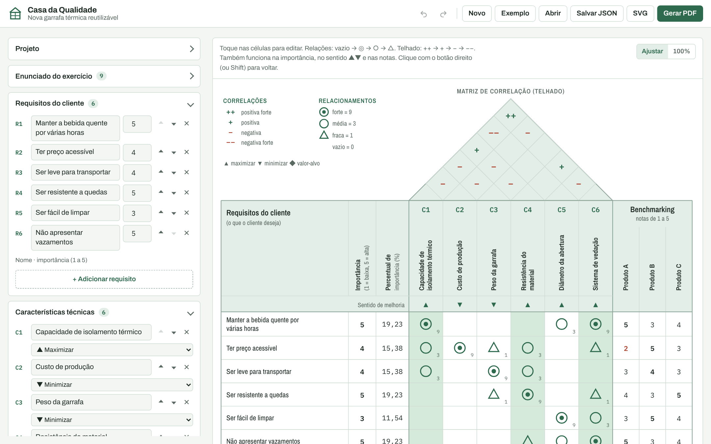

# Casa da Qualidade (QFD)

Editor online da **Casa da Qualidade**, a matriz central do **QFD (Desdobramento da Função Qualidade)**. Você monta o modelo no navegador, os cálculos são refeitos na hora e o resultado sai em PDF pronto para entregar.



## O que dá para fazer

- **Requisitos do cliente** (o que o cliente deseja): adicionar, excluir, reordenar e dar a importância de cada um.
- **Características técnicas** (como atender): adicionar, excluir, reordenar e definir o sentido de melhoria (▲ maximizar, ▼ minimizar, ◆ valor-alvo).
- **Matriz de relacionamentos**: toque na célula da casa para alternar entre vazio → ◎ forte → ○ média → △ fraca.
- **Telhado (matriz de correlação)**: toque no losango para alternar entre ++ → + → − → −−.
- **Benchmarking competitivo**: quantos concorrentes quiser, com notas editáveis no painel ou direto na casa.
- **Escalas configuráveis**: pesos forte/média/fraca (padrão 9, 3 e 1), importância máxima e nota máxima do benchmarking.
- **Cálculos automáticos**: percentual de importância dos requisitos, importância absoluta e percentual de cada característica, ranking e pontuação ponderada dos concorrentes.
- **Análise automática**: pontos fortes e fracos de cada concorrente, melhor concorrente por requisito, lacunas de mercado, características prioritárias com justificativa e conflitos de projeto apontados pelo telhado.
- **Enunciado do exercício** editável: situação-problema, textos das tabelas, atividade proposta e uma lista de etapas e regras que você pode aumentar, reordenar ou excluir.
- **Comentários livres** para cada etapa, que entram no PDF.
- **Dois tipos de PDF**, gerados no próprio navegador, em A4 (padrão), A3, Carta ou Ofício:
  - **Resolução completa:** casa preenchida em uma página na orientação escolhida (paisagem por padrão), seguida das etapas, cálculos e análise em páginas retrato. O enunciado pode entrar no início.
  - **Exercício para preencher à mão:** enunciado com as Tabelas 1, 2 e 3, casa só com os títulos (sem relações, telhado, percentuais nem resultados) e folhas de resposta com tabelas e linhas em branco. Tem campos de nome, turma e data. Requisitos, características, concorrentes e etapas novas entram automaticamente.
- **Salvar e abrir modelos em JSON**, exportar a casa em **SVG**, desfazer e refazer.
- Funciona no celular, com tema claro e escuro. Os dados ficam salvos no próprio navegador.

## Como usar

1. Abra a página (GitHub Pages ou o arquivo `index.html`).
2. Clique em **Exemplo** para ver o exercício da garrafa térmica ou em **Novo** para começar do zero.
3. Preencha requisitos, características e concorrentes no painel da esquerda.
4. Toque nas células da casa para marcar relacionamentos, correlações, importâncias e notas. Clique com o botão direito (ou segure Shift) para voltar um passo.
5. Clique em **Gerar PDF**, escolha o tipo (resolução ou exercício em branco), o papel e as partes, e clique em **Baixar PDF**. O botão **Imprimir** manda as mesmas páginas direto para a impressora.

Para montar o exercício da turma, preencha o painel **Enunciado do exercício** e gere o PDF do tipo **Exercício para preencher à mão**.

Atalhos: `Ctrl+Z` desfazer · `Ctrl+Shift+Z` refazer · `Ctrl+S` salvar JSON · `Ctrl+P` gerar PDF.

Exemplos gerados pelo app: [resolução](docs/exemplo-resolucao-A4.pdf) e [exercício em branco](docs/exemplo-exercicio-em-branco-A4.pdf).

## Como os números são calculados

| Etapa | Fórmula |
|---|---|
| % de importância do requisito | importância ÷ soma das importâncias × 100 |
| Importância da característica | Σ (importância do requisito × peso do relacionamento) |
| % da característica | importância da característica ÷ soma de todas × 100 |
| Pontuação do concorrente | Σ (importância do requisito × nota do concorrente) |

Empates no ranking dividem a mesma posição (1º, 2º, 2º, 4º).

## Publicar no GitHub Pages

O projeto é estático e não tem etapa de build. As bibliotecas de PDF e as fontes já estão no repositório, então funciona até sem internet.

1. Crie um repositório (por exemplo `casa-da-qualidade`) e envie estes arquivos.
2. Em **Settings → Pages**, escolha **Deploy from a branch**, branch `main`, pasta `/ (root)`.
3. Em alguns minutos a página fica em `https://SEU-USUARIO.github.io/casa-da-qualidade/`.

Para rodar localmente, basta abrir `index.html` no navegador.

## Estrutura

```
index.html            página principal
css/style.css         visual da tela (tema claro e escuro)
css/paper.css         visual das páginas do PDF e da impressão
js/fonts.js           fontes embutidas (Archivo, Archivo Narrow, IBM Plex Mono)
js/state.js           modelo de dados, exemplo, validação e salvamento
js/calc.js            cálculos do QFD
js/house.js           desenho da casa em SVG
js/analysis.js        enunciado, etapas 1 a 9 e folhas de resposta
js/editor.js          painel de edição
js/pdf.js             paginação e geração do PDF
js/app.js             eventos, histórico, arquivos e janelas
vendor/               jsPDF e html2canvas (licença MIT)
examples/             modelos em JSON prontos para abrir
docs/                 captura de tela e PDF de exemplo
```

## Formato do JSON

```json
{
  "meta": { "title": "...", "subtitle": "...", "author": "..." },
  "scale": { "s": 9, "m": 3, "w": 1, "impMax": 5, "benchMax": 5 },
  "settings": { "topN": 3 },
  "reqs":  [{ "id": "r1", "name": "Manter a bebida quente", "imp": 5 }],
  "chars": [{ "id": "c1", "name": "Isolamento térmico", "dir": "up" }],
  "comps": [{ "id": "pa", "name": "Produto A" }],
  "rel":   { "r1": { "c1": "s" } },
  "corr":  { "c1|c6": "++" },
  "bench": { "r1": { "pa": 5 } },
  "notes": { "rel": "", "corr": "", "bench": "", "prio": "" },
  "statement": {
    "title": "Construção da Casa da Qualidade (QFD)",
    "context": "Situação-problema…",
    "charIntro": "", "benchIntro": "", "task": "",
    "steps": [{ "id": "e1", "text": "Organize os requisitos…" }]
  }
}
```

`rel` usa `s` (forte), `m` (média) e `w` (fraca). `corr` usa `++`, `+`, `-` e `--`. `dir` aceita `up`, `down`, `target` e `none`.

## Licença

[MIT](LICENSE) © Eduardo Henrique Zuffo

Componentes de terceiros: [jsPDF](https://github.com/parallax/jsPDF) e [html2canvas](https://github.com/niklasvh/html2canvas) (MIT); fontes Archivo, Archivo Narrow e IBM Plex Mono (SIL Open Font License).
